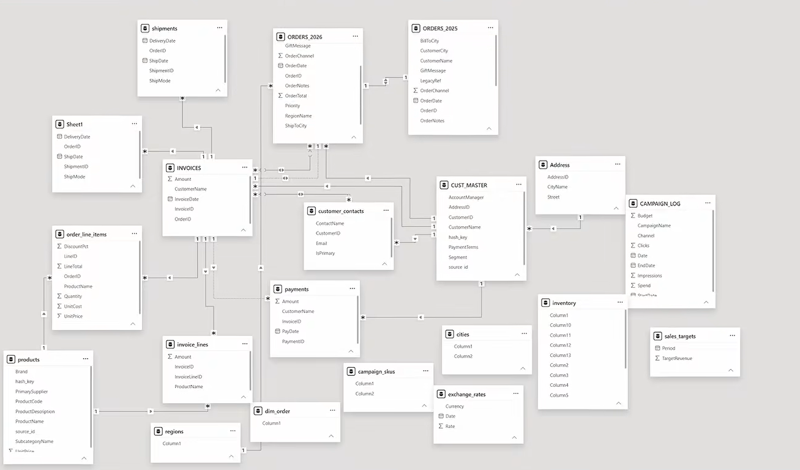
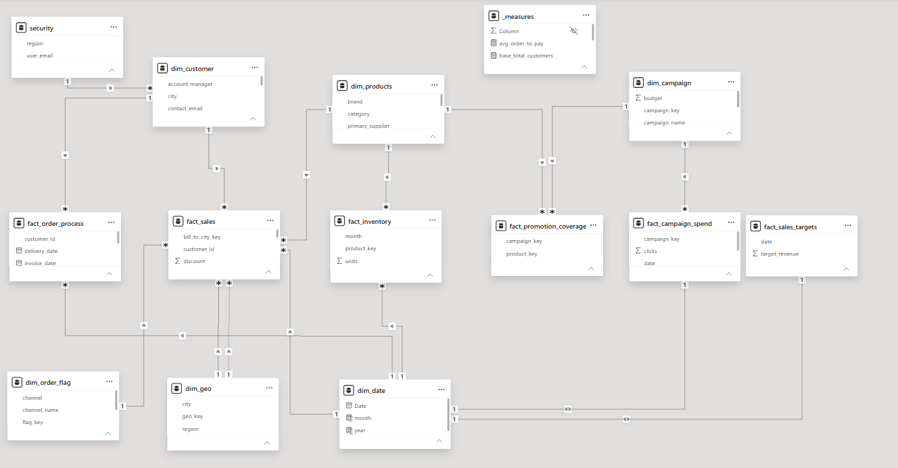

# Power BI Data Modeling & Star Schema Optimization

## Project Overview
This project focuses on transforming a highly complex and unoptimized "nightmare" data model into a clean, efficient, and reporting-ready **Star Schema** in Power BI. 

The original dataset contained unstructured tables, many-to-many relationships, and scattered transactional data. Through extensive data transformation and modeling techniques, the data was optimized for high performance and accurate reporting.

## Tools & Technologies Used
* **Power BI Desktop:** Data visualization and modeling.
* **Power Query:** Data extraction, cleaning, and transformation (ETL).
* **DAX (Data Analysis Expressions):** Creating custom measures for business logic.

## Key Steps & Transformations
1. **ETL with Power Query:** 
   * Organized raw data into structured staging folders.
   * Cleaned data by removing duplicate keys, unnecessary columns, and system junk.
   * Split lists and delimited values to create proper mapping tables.
2. **Dimension Building:** 
   * Consolidated scattered context tables into distinct dimensions (e.g., `dim_customer`, `dim_product`).
   * Generated surrogate keys where business keys were missing or inconsistent.
3. **Fact Table Engineering:** 
   * Merged header and detail tables to create robust fact tables (e.g., `fact_sales`).
   * Created an **Accumulating Snapshot Fact Table** to track the entire order fulfillment process (Order -> Ship -> Delivery -> Invoice -> Pay).
   * Ensured all pre-aggregated totals from source systems were removed and recalculated dynamically using DAX.
4. **Data Modeling (Star Schema):** 
   * Replaced many-to-many chaos with clean **1-to-Many** relationships with single filter directions.
   * Generated an automated Date Dimension using `CALENDARAUTO()`.
5. **Role-Level Security (RLS):** 
   * Implemented dynamic RLS to restrict data access based on the user's assigned region (`USERPRINCIPALNAME()`).

## Repository Contents
* `project_datamodel.pbix`: The final, optimized Power BI project file.
* `dataset.xlsx`: The raw data source used for the transformation.

## Data Model: Before & After

| Before: Nightmare Data Model | After: Clean Star Schema |
|:---:|:---:|
|  |  |

---
*Credits & Acknowledgments: This project was built by following the excellent 'Power BI Data Modeling Portfolio Project' tutorial by Data with Baraa on YouTube. The dataset and core modeling concepts belong to the original creator.*
